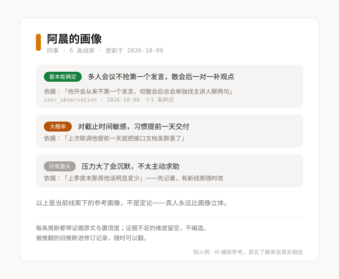
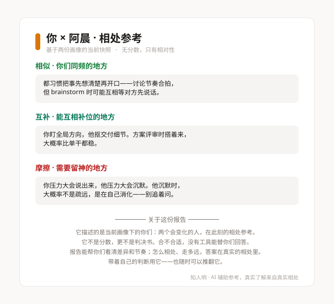

# 知人明 zhirenming

> 知人者智，自知者明。
> 一个帮你把零散线索变成「有依据的理解」的 AI 观察型朋友——WorkBuddy 技能包。

大多数人不缺识人的智商，缺的是一套方法：要么凭感觉给人贴标签，要么被星座血型糊弄。知人明做的事只有一件：**每条判断都挂在证据上，证据不足就明说不足**。

它辅助你判断，**不替你做决定**。

## 它能做什么

| 模块 | 触发词 | 干什么 |
|------|--------|--------|
| **知己** | 「我想认识自己」 | 事件式访谈，把你的经历沉淀成带置信度的自我画像。不问抽象自评，只问具体事件 |
| **知彼** | 「帮我分析一个人」 | 基于你给的线索推理他人画像，每条推断附证据原文与置信度 |
| **补盲** | 「还该了解什么」 | 扫描画像的维度缺口，生成观察任务和自然的提问话术 |
| **匹配** | 「我们俩合不合」 | 双画像对比，输出相似/互补/摩擦三类相对性结论与相处建议。**永远没有百分比分数** |

## 它和别人不一样的地方

**1. 推断三元组：claim + confidence + evidence**
每条推断都是一个可证伪的具体命题，带着置信度（基本能确定 / 大概率 / 只有苗头）和证据原文。没有「你有时候外向有时候内向」这种巴纳姆话术。

**2. 证据不足就拒答，不硬编**
线索少于 3 条不出完整画像；对方高置信推断少于 3 条不做匹配；操控类请求（「怎么拿捏他」）直接拒绝并给正向替代。

**3. 画像会被推翻，也认账**
新证据推翻旧推断时，旧结论进修订记录（revision_history），活跃区只留当前有效判断。你可以随时问：「你之前以为他内向，后来呢？」

**4. 数据只在本地**
画像以 JSON 存在你自己的设备上，建议用化名建档。删掉数据目录即彻底删除，无云端残留。

## 演示

### 他人画像卡（知彼产出示意）



### 匹配报告（匹配产出示意）



### 对话示例

- [知己 · 事件式访谈 → 自我画像](examples/01-zhiji-self-demo.md)
- [知彼 · 线索录入 → 画像 + 补盲清单](examples/02-zhibi-inference-demo.md)
- [匹配 · 双画像对比 → 相处参考（含拒答示范）](examples/03-pipei-match-demo.md)

## 安装（WorkBuddy）

把整个 `zhirenming/` 目录复制到 WorkBuddy 用户级技能目录：

```bash
# Windows (Git Bash)
cp -r zhirenming ~/.workbuddy/skills/zhirenming

# macOS / Linux
cp -r zhirenming ~/.workbuddy/skills/zhirenming
```

新开会话，说「我想认识自己」或「帮我分析一个人」即可触发。

**可选依赖**：脚本优先使用 `jsonschema`（缺失时自动降级为内置校验器，功能不受影响）：

```bash
pip install jsonschema   # 可选，Python 3.10+
```

详细说明见 [zhirenming/INSTALL.md](zhirenming/INSTALL.md)。

## 仓库结构

```
├── zhirenming/              # 技能包本体（WorkBuddy 加载的就是这个目录）
│   ├── SKILL.md             # 技能入口：触发词、路由、全局硬约束
│   ├── INSTALL.md           # 安装与卸载说明
│   ├── references/          # 按需加载的领域知识（Progressive Disclosure）
│   │   ├── ethics.md        # 伦理红线 / 拒答话术 / N1-N5 定位提示文案源
│   │   ├── prompts/         # 四模块引擎提示词（知己/知彼/补盲/匹配）
│   │   ├── schemas/         # 画像 JSON Schema 与维度规范
│   │   └── theory/          # 大五人格、依恋理论等理论锚点
│   └── scripts/             # 确定性兜底脚本（纯 stdlib，零网络）
│       ├── validate_profile.py   # 画像 Schema 校验（--strict 置信度软告警）
│       ├── gap_scan.py           # 维度缺口扫描（match_ready 判定）
│       └── fixtures/             # 17 个回归测试夹具
├── examples/                # 三份完整对话演示
├── docs/images/             # 产品示意图（SVG）
├── CHANGELOG.md
└── LICENSE
```

## 工作原理（三层设防）

1. **契约层**：`profile.schema.json`（draft-07）定义画像唯一合法形状
2. **约束层**：提示词内嵌校准规则——「先数证据再定级，禁止先拍级再找补」
3. **校验层**：每次写入后必跑 `validate_profile.py`，失败回炉且不覆盖原文件

```bash
# 校验一份画像
python zhirenming/scripts/validate_profile.py <画像路径>

# 严格模式：置信度软告警（high 但证据不足时告警，不阻断）
python zhirenming/scripts/validate_profile.py <画像路径> --strict

# 扫描维度缺口 / 判断是否可匹配
python zhirenming/scripts/gap_scan.py <画像路径> --format json
```

## 伦理边界

- **只给理解，不教操控。** 「怎么让他听我的」类请求会被拒绝，并给一个尊重对方的替代问法。
- **辅助而非决定。** 首次使用、画像产出、补盲清单、匹配报告等关键节点都有固定提示：这是参考，不是结论；真实的了解来自真实的相处。
- **建议化名建档**，不存储可识别第三方真实身份的信息。

## 版本

当前 **v1.1**（2026-10-09）——见 [CHANGELOG.md](CHANGELOG.md)。
v1.0 经两轮测试签发：验收标准 15/15 通过，P0/P1 缺陷为零；安全审计 P2（零外发、零密钥、零网络行为）。

## License

[MIT](LICENSE)
